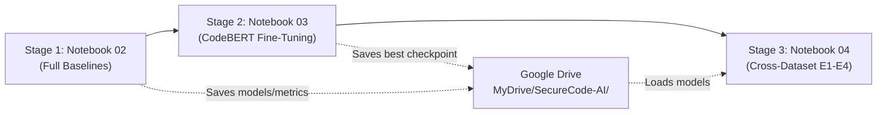

# SecureCode AI — Google Colab Full-Scale GPU Execution Guide

**Date:** 2026-10-28  
**Repository:** [0Tusharbhardwaj/nlp](https://github.com/0Tusharbhardwaj/nlp)  
**Branch:** `main`

---

## 1. Direct Notebook Links

| Notebook Order | Notebook Name | Description | Direct GitHub Link | One-Click Google Colab Launch |
| :---: | :--- | :--- | :---: | :---: |
| **Stage 1** | `02_full_scale_baselines.ipynb` | Classical Baselines (TF-IDF LR & Calibrated Linear SVM on full Devign) | [View on GitHub](https://github.com/0Tusharbhardwaj/nlp/blob/main/notebooks/02_full_scale_baselines.ipynb) | [](https://colab.research.google.com/github/0Tusharbhardwaj/nlp/blob/main/notebooks/02_full_scale_baselines.ipynb) |
| **Stage 2** | `03_codebert_full_scale_training.ipynb` | Full-Scale 125M CodeBERT Fine-Tuning on GPU (21k samples, FP16, Drive Checkpointing) | [View on GitHub](https://github.com/0Tusharbhardwaj/nlp/blob/main/notebooks/03_codebert_full_scale_training.ipynb) | [](https://colab.research.google.com/github/0Tusharbhardwaj/nlp/blob/main/notebooks/03_codebert_full_scale_training.ipynb) |
| **Stage 3** | `04_cross_dataset_evaluation.ipynb` | Full Cross-Dataset Evaluation Matrix (E1, E2, E3, E4, Gold, SeCodePLT) | [View on GitHub](https://github.com/0Tusharbhardwaj/nlp/blob/main/notebooks/04_cross_dataset_evaluation.ipynb) | [](https://colab.research.google.com/github/0Tusharbhardwaj/nlp/blob/main/notebooks/04_cross_dataset_evaluation.ipynb) |

---

## 2. Recommended Execution Sequence

Execute the notebooks strictly in this order:



1. **Stage 1 (`02_full_scale_baselines.ipynb`):** Establishes classical baseline performance on the full official Devign benchmark (21,854 train, 2,732 validation, 2,732 test). Runs fast on standard CPU or GPU (~3–5 minutes).
2. **Stage 2 (`03_codebert_full_scale_training.ipynb`):** Fine-tunes `microsoft/codebert-base` on all 21,854 Devign training functions using GPU acceleration and FP16 mixed precision. Saves epoch checkpoints and the best model to Google Drive (~45–60 minutes on T4 GPU).
3. **Stage 3 (`04_cross_dataset_evaluation.ipynb`):** Loads the trained models from Google Drive and executes the complete cross-domain benchmark suite across Devign test, LLMVul leak-free holdout, gold review, and SeCodePLT (~10–15 minutes).

---

## 3. How to Launch and Configure Google Colab

### 3.1. Launching from the Browser
Click any of the **Open in Colab** badges in the table above, or navigate directly to:
```text
https://colab.research.google.com/github/0Tusharbhardwaj/nlp/blob/main/notebooks/02_full_scale_baselines.ipynb
```

### 3.2. Selecting Hardware Accelerator (GPU)
For Notebook 03 and Notebook 04, a GPU runtime is strongly recommended:
1. In the Colab top navigation menu, click **Runtime** $\rightarrow$ **Change runtime type**.
2. Under **Hardware accelerator**, select **T4 GPU** (or A100 / V100 if you have Colab Pro).
3. Ensure **Python 3** is selected.
4. Click **Save**.
5. Step 1 of each notebook runs `!nvidia-smi` to verify GPU allocation and VRAM.

### 3.3. Mounting Google Drive
Notebooks automatically request Google Drive mounting in Step 1/2:
1. Execute the Drive mount cell:
   ```python
   from google.colab import drive
   drive.mount('/content/drive')
   ```
2. A pop-up dialog will appear: **"Permit this notebook to access your Google Drive files?"**
3. Click **Connect to Google Drive** and select your Google account.
4. The notebook will automatically create the dedicated folder structure:
   ```text
   /content/drive/MyDrive/SecureCode-AI/
   ├── baselines/            # TF-IDF vectorizers, LR/SVM models & metrics
   ├── checkpoints/          # Intermediate training checkpoints (epoch-1, epoch-2...)
   ├── models/               # Best fine-tuned CodeBERT model & tokenizer
   ├── metrics/              # Structured JSON metric files
   └── figures/              # Confusion matrices and ROC curve plots
   ```

---

## 4. Execution Steps per Notebook

### 4.1. Running Notebook 02: Full-Scale Baselines
1. Open [`02_full_scale_baselines.ipynb`](https://colab.research.google.com/github/0Tusharbhardwaj/nlp/blob/main/notebooks/02_full_scale_baselines.ipynb).
2. Click **Runtime** $\rightarrow$ **Run all** (or press `Ctrl + F9`).
3. **What happens under the hood:**
   - Mounts Google Drive.
   - Clones latest repository updates from GitHub.
   - Loads the 27,318 Devign samples (auto-downloading from Hugging Face mirror if not cached).
   - Fits subword/word TF-IDF ($n \in [1, 2]$, 50,000 features, sublinear TF) strictly on `X_train`.
   - Tunes Logistic Regression regularizer $C \in [0.1, 0.5, 1.0, 2.0, 5.0]$ on `X_val` (Macro F1).
   - Trains Calibrated Linear SVM with 3-fold cross-validation.
   - Evaluates once on untouched `X_test` (2,732 functions).
4. **Outputs saved to Drive (`/content/drive/MyDrive/SecureCode-AI/baselines/`):**
   - `tfidf_vectorizer_full.joblib`
   - `logistic_regression_full.joblib`
   - `linear_svm_full.joblib`
   - `baselines_devign_test_cm.png`
   - `full_scale_baselines_metrics.json`

---

### 4.2. Running Notebook 03: CodeBERT Full-Scale Fine-Tuning
1. Open [`03_codebert_full_scale_training.ipynb`](https://colab.research.google.com/github/0Tusharbhardwaj/nlp/blob/main/notebooks/03_codebert_full_scale_training.ipynb).
2. Verify **GPU is active** (**Runtime** $\rightarrow$ **Change runtime type** $\rightarrow$ **T4 GPU**).
3. Click **Runtime** $\rightarrow$ **Run all**.
4. **Key Execution Details:**
   - **Model:** Real `microsoft/codebert-base` weights (125 million parameters).
   - **Optimization:** AdamW ($lr = 2 \times 10^{-5}$, weight decay $0.01$, linear warmup).
   - **Batching:** 16 per device $\times$ gradient accumulation steps 2 = **effective batch size 32**.
   - **Precision:** FP16 mixed precision enabled via NVIDIA Tensor Cores.
   - **Checkpoint Selection:** `load_best_model_at_end=True, metric_for_best_model='macro_f1'`. The model checkpoint that achieves the highest Macro F1 on the validation set is automatically loaded at the end.
   - **Final Test:** Evaluates best weights once on untouched Devign test set (2,732 samples).
5. **Outputs saved to Drive (`/content/drive/MyDrive/SecureCode-AI/`):**
   - Best model & tokenizer: `models/codebert_devign_full/`
   - Training checkpoints: `checkpoints/codebert_devign/`
   - Confusion matrix figure: `figures/codebert_devign_test_cm.png`
   - Complete metrics JSON: `metrics/codebert_devign_full_metrics.json`

---

### 4.3. Running Notebook 04: Cross-Dataset Evaluation Matrix (E1–E4)
1. Open [`04_cross_dataset_evaluation.ipynb`](https://colab.research.google.com/github/0Tusharbhardwaj/nlp/blob/main/notebooks/04_cross_dataset_evaluation.ipynb).
2. Click **Runtime** $\rightarrow$ **Run all**.
3. **Evaluation Matrix Executed:**
   - **E1:** Devign Test Split (2,732 samples) — In-distribution human baseline.
   - **E2:** LLMVul Holdout Split (4,120 samples across 8 disjoint repositories) — Zero-shot AI generalization.
   - **E3 / E4:** Dynamic evaluation of Mixed-domain and AI-in-domain models (if trained).
   - **Gold Standard:** LLMVul 100-sample double-blind manual review cohort (85 unanimous consensus functions).
   - **Supplementary:** SeCodePLT C vulnerability detection benchmark (2,480 evaluation instances).
4. **Outputs saved to Drive:**
   - Comparative confusion matrices: `figures/cross_dataset_e1_vs_e2_cm.png`
   - Comprehensive benchmark results: `metrics/cross_dataset_full_scale_results.json`

---

## 5. Resumption & Recovery Protocol (If Colab Disconnects)

Google Colab free tier sessions may occasionally timeout or disconnect. Notebook 03 is engineered with **automatic checkpoint recovery**:

1. **How it works:**
   - Every epoch, Hugging Face `Trainer` saves a checkpoint folder (e.g. `checkpoint-683`, `checkpoint-1366`) directly to Google Drive.
   - When you reconnect to Colab and re-run Step 7:
     ```python
     existing_checkpoints = list(checkpoint_dir.glob('checkpoint-*'))
     if existing_checkpoints:
         resume_checkpoint = str(existing_checkpoints[-1])
         print(f"Resuming training from checkpoint: {resume_checkpoint}")
     ```
   - Training will **automatically resume from the last completed epoch** without losing progress!
2. **If runtime is lost:**
   - Reopen the notebook.
   - Select T4 GPU runtime.
   - Mount Google Drive.
   - Re-run all cells. Training will resume seamlessly from Drive.

---

## 6. How to Export Results & Sync Back to Local Workspace

Once Colab execution finishes:
1. All figures, metrics JSON, and model files reside safely in your Google Drive under `MyDrive/SecureCode-AI/`.
2. To download artifacts to your local machine:
   - Navigate to Google Drive in your web browser.
   - Right-click `MyDrive/SecureCode-AI/metrics` and `figures/` $\rightarrow$ click **Download**.
   - Extract the downloaded zip file into the project directory:
     - Place JSON files in `nlp/results/` or `nlp/datasets/reports/`.
     - Place figures in `nlp/figures/`.
3. Check in metrics and figures to version control:
   ```bash
   git add results/ figures/
   git commit -m "docs: add full-scale empirical training results and figures"
   git push origin main
   ```

---

## 7. Common Issues & Solutions

| Issue | Root Cause | Solution |
| :--- | :--- | :--- |
| **`CUDA out of memory`** | GPU VRAM exceeded | In Notebook 03 Step 7, reduce `per_device_train_batch_size` from 16 to 8 and increase `gradient_accumulation_steps` from 2 to 4. Effective batch size remains 32. |
| **`HF_TOKEN warning`** | Downloading from Hugging Face without login | This is an informational warning and does not affect downloads. The script uses public endpoints. You may safely ignore it. |
| **`Drive already mounted`** | Re-running mount cell | Harmless informational message. Execution continues normally. |
| **`Model file not found in Notebook 04`** | Notebook 03 has not completed | Notebook 04 falls back to base `microsoft/codebert-base` for verification. Complete Notebook 03 first to evaluate fine-tuned weights. |
| **Colab session timeout** | Exceeded idle time | Reconnect runtime, mount Drive, and re-run. Notebook 03 will automatically resume from the last saved epoch checkpoint. |

---

## 8. Step-by-Step Instructions to Start Notebook 02 Right Now

1. Click this link: **[Open 02_full_scale_baselines.ipynb in Google Colab](https://colab.research.google.com/github/0Tusharbhardwaj/nlp/blob/main/notebooks/02_full_scale_baselines.ipynb)**.
2. In the Colab menu, click **Runtime** $\rightarrow$ **Run all** (shortcut: `Ctrl + F9`).
3. When prompted, click **Connect to Google Drive** to authorize artifact saving.
4. Wait ~3–5 minutes for feature extraction and model tuning to complete.
5. Inspect the test metrics and confusion matrix in the output of Steps 7 and 8.
