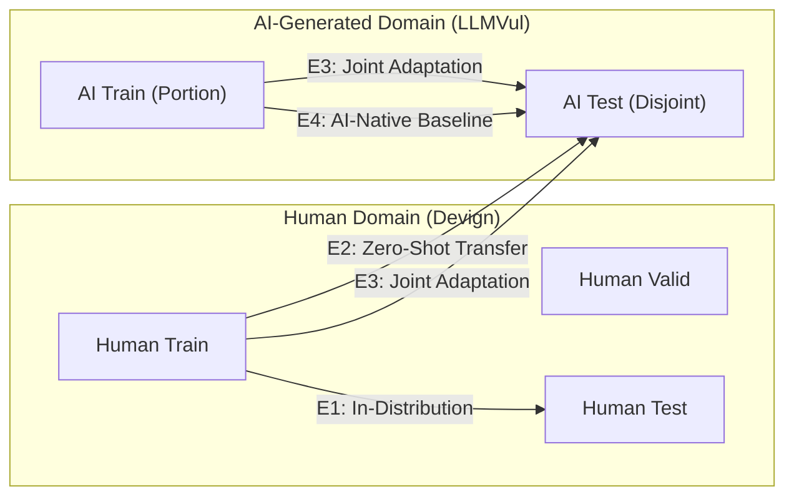

# SecureCode AI — Research & Experiment Plan

## 1. Scientific Objective & Motivation

Recent advancements in Large Language Models (LLMs) like GPT-4, Claude, and CodeLlama have dramatically accelerated software development. However, LLM-generated code frequently reproduces known Common Weakness Enumerations (CWEs) or introduces subtle semantic flaws that evade traditional linters.

Most existing vulnerability detection models are trained on historical human-written code bases (e.g., open-source C/C++ projects such as Linux kernel, QEMU, FFmpeg). This raises a critical security question:

> **Core Research Question**: Can machine learning models trained on human-written source code generalize to detect security vulnerabilities in AI-generated and AI-assisted code?

---

## 2. Formal Research Questions

- **RQ1 (In-Distribution Efficacy)**: How effectively do classical lexical models (TF-IDF + Logistic Regression, TF-IDF + Linear SVM) versus pretrained contextual representations (CodeBERT) detect vulnerabilities on human-written C/C++ code (CodeXGLUE/Devign)?
- **RQ2 (Cross-Distribution Transfer)**: When a model trained strictly on human code is evaluated on AI-generated code (LLMVul), what is the performance drop, and specifically how significantly does the **False Negative Rate (FNR)** increase?
- **RQ3 (Domain Adaptation)**: Does fine-tuning CodeBERT on a combination of human code and a subset of AI-generated code mitigate the cross-domain vulnerability blind spots on unseen AI-generated code?
- **RQ4 (Error & CWE Analysis)**: What types of vulnerabilities (e.g., buffer overflows vs. memory leaks vs. pointer arithmetic) are disproportionately missed in AI-generated code?

---

## 3. Dataset Investigation & Harmonization Plan

To avoid artificial metrics and ensure scientific honesty, the datasets are audited for provenance, licensing, and schema compatibility before combination:

| Dataset | Provenance | Source Type | Language | Tasks & Granularity | Role in Experiments |
| :--- | :--- | :--- | :--- | :--- | :--- |
| **CodeXGLUE / Devign** | Human OSS (QEMU/FFmpeg) | Human-written | C / C++ | Function-level binary classification (0: Safe, 1: Vuln) | Primary Training & In-Distribution Benchmark |
| **LLMVul** | LLM Code Generations | AI-generated | C / C++, Python | Prompts, completions, vulnerability labels | Cross-Distribution External Test Set (E2) |
| **SECODEPLT** | Benchmark Suite | AI Generations | Diverse | Security prompt evaluations & CWE testing | Supplementary Security Analysis |
| **HumanVsAICode** | Comparative Study | Paired Human vs AI | Python / C | Matched functional pairs with security flags | Comparative Paired Generalization Study |

### Common Internal Schema
Where compatible, samples are converted to:
```text
sample_id: str               # Unique identifier
source_dataset: str          # Name of benchmark (e.g., 'devign', 'llmvul')
code: str                    # Original raw function source code
label: int                   # 0 (Non-vulnerable) or 1 (Vulnerable)
language: str                # Programming language ('c', 'cpp', 'python')
provenance: str              # Origin metadata ('human', 'gpt-4', 'codellama', etc.)
repository_id: Optional[str] # Project or repository identifier
cwe_id: Optional[str]        # CWE identifier if cataloged (e.g., 'CWE-119')
label_confidence: float      # 1.0 for verified ground truth; <1.0 for ambiguous
split: str                   # 'train', 'valid', 'test', or 'external'
```

*Rule: Missing fields are populated with `null`/`None`. No ground-truth values or CWE IDs are synthesized.*

---

## 4. Controlled Experimental Matrix



### Experiment Specifications:
1. **Experiment 1 (E1: In-Distribution Human Baseline)**
   - Train: `Devign.train` (80%)
   - Validate: `Devign.valid` (10%)
   - Test: `Devign.test` (10% held-out)
   - Evaluates baseline capacity under ideal in-distribution conditions.

2. **Experiment 2 (E2: Zero-Shot Cross-Distribution Evaluation)**
   - Train: `Devign.train`
   - Test: `LLMVul` (Untouched AI-generated test set)
   - Directly measures domain shift and false negative vulnerability risk.

3. **Experiment 3 (E3: Joint Domain Adaptation)**
   - Train: `Devign.train` + Disjoint AI training subset (50% of AI data)
   - Test: Held-out disjoint AI test subset (50% of AI data)
   - Evaluates whether joint training recovers recall on AI-generated patterns without degrading human test metrics.

4. **Experiment 4 (E4: AI-Native Training)**
   - Train: AI training subset
   - Test: AI test subset
   - Assesses whether an AI-only trained model outperforms a human-trained model on AI code.

---

## 5. Candidate Models & Hyperparameters

### Model 1: TF-IDF + Logistic Regression (Lexical Baseline)
- Vectorization: Sublinear TF, N-grams (1, 2), max_features = 10,000, min_df = 3.
- Classifier: L2 penalty, C = 1.0, class_weight = 'balanced', solver = 'lbfgs', max_iter = 1000.

### Model 2: TF-IDF + Linear SVM (Margin Baseline)
- Vectorization: Identical TF-IDF configuration to ensure direct comparability.
- Classifier: LinearSVC, squared_hinge loss, C = 1.0, class_weight = 'balanced'.

### Model 3: Microsoft CodeBERT (Deep Contextual Transformer)
- Architecture: `microsoft/codebert-base` (12-layer, 768-hidden, 12-heads, 125M parameters) with a sequence classification head on `[CLS]`.
- Tokenizer: Byte-Pair Encoding (BPE) pretrained on CodeSearchNet (6 programming languages).
- Sequence length: 512 tokens (analyzed against function length distributions).
- Optimizer: AdamW (`lr = 2e-5`, `weight_decay = 0.01`, `warmup_ratio = 0.1`).
- Precision: FP16 mixed precision on NVIDIA GPU (Google Colab).
- Selection criterion: Highest validation macro F1-score across 3 epochs.

---

## 6. Evaluation Metrics & Security Analysis

In security vulnerability detection, missed vulnerabilities (False Negatives) carry severe real-world risk. Therefore, evaluation emphasizes:

1. **Accuracy**: Overall fraction of correct predictions.
2. **Precision ($\frac{TP}{TP + FP}$)**: Reliability of a positive vulnerability alert.
3. **Recall / True Positive Rate ($\frac{TP}{TP + FN}$)**: Proportion of actual vulnerabilities flagged.
4. **F1-Score**: Harmonic mean of Precision and Recall.
5. **False Negative Rate (FNR)**:
   $$\text{FNR} = \frac{FN}{TP + FN} = 1 - \text{Recall}$$
   *The primary metric indicating vulnerability escape rate into production.*
6. **ROC-AUC**: Area under the Receiver Operating Characteristic curve.
7. **Confusion Matrix**: Full breakdown of $(TP, FP, TN, FN)$.

---

## 7. Data Leakage & Reproducibility Safeguards

- **Deterministic Seeds**: Random seed `42` enforced across all splits, initializations, and training loops.
- **Repository-Level Disjoint Splits**: Verification that functions belonging to the same project or commit do not span both train and test splits.
- **Deduplication Check**: Exact (MD5) and near-duplicate (MinHash) screening across train and test partitions.
- **Untouched Test Policy**: Test sets are evaluated exactly once per model after final checkpoint selection based on validation data.
- **Audit Trails**: Every experiment saves its git commit hash, configuration file, random seed, loss curves, and confusion matrix image in `results/`.
