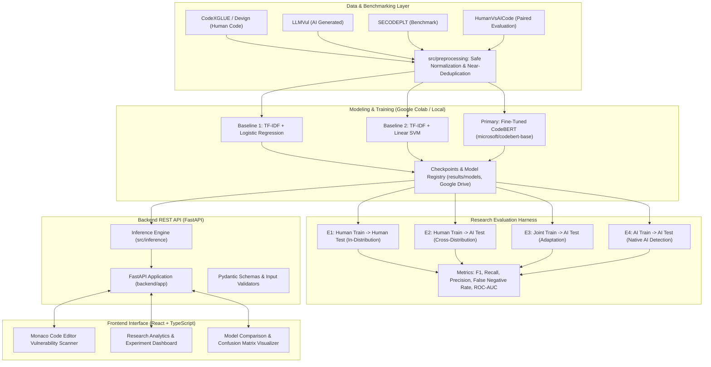

# SecureCode AI — System Architecture Specification

## 1. Executive Overview

**SecureCode AI** is an empirical, research-grade machine learning platform designed to detect security vulnerabilities in source code. Its primary scientific objective is to investigate whether models trained exclusively on human-written software (such as the Devign / CodeXGLUE vulnerability benchmark) can reliably identify vulnerabilities in code authored or assisted by Large Language Models (LLMs).

To maintain scientific integrity and production reliability, SecureCode AI decouples:
1. **Machine Learning Pipeline**: Data ingestion, normalization, tokenization, training, and cross-distribution evaluation.
2. **Backend Inference Engine**: Asynchronous, validated REST API (FastAPI) providing real inference.
3. **Frontend Analytics Platform**: Modern React + TypeScript + Tailwind CSS application featuring Monaco Editor code scanning and real experimental visualizations.

---

## 2. System Architecture Diagram



---

## 3. Directory Structure & Component Responsibilities

```text
SecureCode-AI/
├── datasets/                       # Dataset storage (excluded from git)
│   ├── raw/                        # Original, unmodified benchmark downloads
│   ├── processed/                  # Normalized, deduplicated, tokenized splits
│   ├── external/                   # Supplementary evaluation sets (e.g. LLMVul)
│   └── reports/                    # Dataset profile reports & schema audits
├── notebooks/                      # Colab-ready Jupyter notebooks for training
│   └── 01_codebert_finetuning.ipynb
├── src/                            # Core Machine Learning source package
│   ├── data/                       # Ingestion scripts & schema harmonizers
│   ├── preprocessing/              # Tokenization, safe comment handling, dedup
│   ├── models/                     # PyTorch CodeBERT & Scikit-learn baselines
│   ├── training/                   # Trainer loop, loss functions, checkpointing
│   ├── evaluation/                 # Metrics calculator, FNR, confusion matrices
│   ├── inference/                  # Low-latency prediction pipeline
│   └── utils/                      # Config loaders, seeds, logging, hardware
├── backend/                        # FastAPI Web Application
│   └── app/
│       ├── api/                    # Route handlers (scan, models, experiments)
│       ├── services/               # Model loading & orchestration layer
│       ├── schemas/                # Pydantic request/response schemas
│       ├── core/                   # Config, security, CORS, environment
│       └── main.py                 # FastAPI application factory
├── frontend/                       # React + TypeScript + Monaco Editor UI
├── configs/                        # YAML configuration files
│   └── base.yaml                   # Central project & hyperparameter config
├── scripts/                        # Reproducible CLI scripts for training/eval
├── tests/                          # Pytest suite for ML, API, and integrity
├── results/                        # Outputs (excluded from git except .gitkeep)
│   ├── checkpoints/                # PyTorch epoch checkpoints
│   ├── models/                     # Saved models & vectorizers
│   ├── metrics/                    # JSON/CSV evaluation metrics
│   ├── figures/                    # Saved confusion matrices & ROC curves
│   └── logs/                       # Application & training log outputs
├── docs/                           # Research & architecture documentation
│   ├── PROJECT_ARCHITECTURE.md     # System design & component contracts
│   └── EXPERIMENT_PLAN.md          # Controlled scientific experiment plan
├── .env.example                    # Template environment variables
├── .gitignore                      # Git exclusion rules
├── requirements.txt                # Python 3.11 dependency manifest
└── README.md                       # Main project documentation & setup
```

---

## 4. Architectural Separation Principles

### 4.1 ML Pipeline vs. Backend Serving Separation
- **No Training inside API**: The FastAPI backend (`backend/app`) only consumes saved model weights (`results/models/`). Retraining or fine-tuning never occurs during API requests.
- **Model Registry Singleton**: Models and tokenizers are loaded once during application startup using FastAPI lifespan events, preventing cold-start latency and out-of-memory errors on concurrent calls.
- **Graceful Degradation**: If deep learning checkpoints are absent, the API can gracefully fall back to classical baselines or return explicit diagnostic status rather than crashing.

### 4.2 Independent Frontend
- The frontend in `frontend/` is an independent Single Page Application (SPA).
- It interacts with the backend strictly through authenticated, typed REST endpoints (`/api/v1/...`).
- No fake predictions or synthetic benchmark figures are hardcoded in the frontend. If models or experiment records are missing, honest empty states are presented.

### 4.3 Safe Preprocessing
- **Controlled Cleaning**: Classical lexical models (TF-IDF) receive tokenized source code with optional safe whitespace normalization. Comments are **never** stripped using unsafe regular expressions that might corrupt multi-line strings, regex literals, or URLs.
- **CodeBERT Preservation**: Transformer models receive raw code structure intact; CodeBERT's BPE tokenizer relies on identifier tokens, brackets, and indentation structure to extract semantic cues.

---

## 5. Security & Scientific Rigor Guidelines

1. **No Data Fabrication**: Experimental metrics, confusion matrices, and model scores are generated strictly from executing code on real benchmark splits.
2. **Leakage Prevention**:
   - Strict separation between Training, Validation, and Test sets.
   - Near-duplicate detection across splits using MinHash/SimHash to ensure that repeated functions in public repositories do not inflate evaluation scores.
   - External test sets (such as AI-generated code from LLMVul) are strictly kept out of training and hyperparameter search.
3. **No Hardcoded Credentials**: API secrets, private paths, and environment tokens are managed through `.env` and loaded via Pydantic settings.
4. **Reproducibility**: Random seeds (seed = 42) are fixed deterministically across PyTorch, NumPy, Python, and Scikit-learn.
