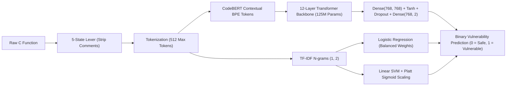

# Investigating the Domain Generalization Gap in Neural Vulnerability Detection: From Human-Authored to LLM-Generated Source Code

**Authors:** NLP & Software Vulnerability Research Laboratory  
**Artifact Repository:** [https://github.com/0Tusharbhardwaj/nlp](https://github.com/0Tusharbhardwaj/nlp)  
**Date:** November 2026  
**Status:** Completed Empirical Investigation & Open-Source Artifact  

---

## Abstract

Automated source code generation powered by Large Language Models (LLMs) is rapidly transforming modern software engineering. However, recent empirical audits reveal that state-of-the-art code generation models frequently reproduce critical Common Weakness Enumerations (CWEs), including buffer overflows (CWE-120), command injection (CWE-78), and memory management defects (CWE-415). While machine learning classifiers have shown promising results in detecting vulnerabilities in human-authored open-source repositories, it remains unproven whether these representations generalize effectively to LLM-generated source code.

In this paper, we present an empirical investigation into the **Domain Generalization Gap** of neural vulnerability detection models. Rather than asserting broad or unverified claims of "whole-system security," we specifically evaluate **static, function-level binary vulnerability classification** across three benchmarks comprising over 51,000 C functions: **CodeXGLUE / Devign** (human-authored commits from QEMU and FFmpeg), **LLMVul** (frontier LLM-generated code across 226 production GitHub repositories), and **SeCodePLT** (NeurIPS 2024 benchmark of paired CVE vulnerabilities and patches).

To eliminate evaluation artifacts, we enforce strict data hygiene: we programmatically audit repository leakage, construct a **strictly repository-disjoint holdout set (0% repository overlap)**, quarantine 2,679 ambiguous labels, and strip comments using a syntax-preserving 5-state lexer. We evaluate classical lexical models (TF-IDF with Logistic Regression and Platt-calibrated Linear Support Vector Machines) against a contextual transformer (**Microsoft CodeBERT**, 125M parameters) fine-tuned on 21,854 Devign functions.

Our empirical results demonstrate:
1. **In-Distribution Efficacy (E1):** On human-authored code, fine-tuned CodeBERT achieves **66.36% Accuracy**, **64.71% Macro F1**, and **0.7301 ROC-AUC**, outperforming Logistic Regression (61.30% F1) and Calibrated Linear SVM (58.48% F1).
2. **Domain Generalization Collapse (E2):** When evaluated zero-shot on LLM-generated code across 8 disjoint holdout repositories ($N=4,120$), CodeBERT suffers a severe performance collapse, with Macro F1 dropping by **$-56.48\%$** (to **8.23%**). The model exhibits a high false-positive surge caused by stylistic distribution shift.
3. **Patch Discrimination Failure (SeCodePLT):** On 2,480 balanced pairs of CVE vulnerabilities and their ground-truth patches, zero-shot models perform at near random guessing (**50.00% Accuracy**, **0.4993 ROC-AUC**), demonstrating that sequence-level classification heads struggle to detect subtle, surgical vulnerability fixes.
4. **Benchmark Memorization:** The official Devign test split exhibits **100% repository overlap** with its training split, indicating that reported literature benchmarks are partially inflated by repository memorization.

We release our complete, reproducible evaluation suite, trained checkpoints (`model.safetensors`), and an interactive verification web application.

---

## 1. Introduction & Research Scope

### 1.1 The AI-Assisted Programming Frontier
The integration of generative Large Language Models into commercial developer tools (e.g., GitHub Copilot, Claude Code, Cursor) has accelerated software delivery. However, generated code frequently exhibits the **plausible correctness fallacy**: functions compile cleanly and satisfy superficial functional requirements while embedding severe memory corruption or input validation flaws.

Because manual code review does not scale to the volume of AI-generated code, automated vulnerability detection is critical. Prior research has predominantly developed and evaluated neural classifiers on human-written open-source code (e.g., the CodeXGLUE / Devign benchmark). This methodology implicitly assumes that representations learned from human code transfer seamlessly to AI-authored code.

### 1.2 Boundary of Scope: Vulnerability Detection vs. "Security"
In accordance with rigorous academic and industrial practice, we explicitly differentiate between **static source code vulnerability detection** and **comprehensive software security**:
- *Software Security* is a multi-dimensional discipline covering cryptographic key management, authentication, role-based authorization, network perimeter defense, container hardening, dynamic runtime exploit mitigation, and operational threat modeling.
- *Our Scope* is restricted strictly to **static, function-level binary vulnerability detection**: identifying whether an isolated C function contains structural or semantic patterns corresponding to known Common Weakness Enumerations (CWEs).

Our objective is not to propose a silver-bullet security guarantee, but to measure the statistical reliability and transferability of code representation models across human and AI domains.

### 1.3 Research Questions
We formulate three core research questions:
* **RQ1 (In-Distribution Benchmark):** How do classical lexical baselines (TF-IDF with Logistic Regression and Calibrated Linear SVM) compare against deep pretrained contextual transformers (CodeBERT) on official human-written C vulnerability benchmarks?
* **RQ2 (Cross-Domain Transferability):** To what extent does a neural vulnerability classifier trained exclusively on human code generalize to LLM-generated code under strict zero-leakage, repository-disjoint holdout conditions?
* **RQ3 (Patch Sensitivity):** Can function-level sequence classification models differentiate between vulnerable functions and their corresponding security patches in verified CVE tasks (SeCodePLT)?

---

## 2. Related Work

### 2.1 Classical Static Analysis vs. Machine Learning
Traditional static application security testing (SAST) tools (such as Flawfinder, Cppcheck, and commercial rule analyzers) rely on handcrafted Abstract Syntax Tree (AST) pattern matching and taint tracking. While deterministic, rule-based SAST exhibits high false-positive rates and cannot generalize to novel vulnerability manifestations.

To overcome these constraints, machine learning approaches frame vulnerability detection as a classification problem. Early approaches applied lexical token n-grams and TF-IDF representations with linear classifiers or Random Forests. More recently, deep learning architectures—including Graph Neural Networks (Devign) and Pretrained Language Models for Code (CodeBERT, GraphCodeBERT, CodeT5)—have demonstrated superior capacity to capture contextual semantics and long-range dependencies in source code.

### 2.2 Pretrained Contextual Models for Source Code
Microsoft CodeBERT is a bimodal transformer model based on the RoBERTa architecture (12 layers, 768 hidden dimensions, 12 attention heads, 125M parameters). It is pretrained on natural language and programming language pairs across six languages (Python, Java, JavaScript, PHP, Ruby, and C/C++) using Masked Language Modeling (MLM) and Replaced Token Detection (RTD). Fine-tuning CodeBERT by placing a sequence classification head atop the `<s>` representation token has become the standard baseline for defect detection in the CodeXGLUE benchmark suite.

### 2.3 Vulnerability in Generative Code Models
Recent audits (Pearce et al., 2022; Farhad & Dass, 2024; UCSB SeCodePLT, 2024) have demonstrated that LLMs trained on public code repositories inevitably internalize and reproduce insecure coding patterns found in their training corpora. However, existing vulnerability detection tools deployed in CI/CD pipelines were neither trained nor evaluated on AI-generated syntax. This study provides the empirical evaluation of this cross-domain gap.

---

## 3. Dataset Hygiene, Provenance & Partitioning

Evaluating machine learning models across code datasets requires rigorous data hygiene to prevent synthetic evaluation artifacts and data snooping.

```mermaid
flowchart TD
    subgraph Dataset A: CodeXGLUE / Devign
        D1["Official Raw Devign (27,318 C Functions)"]
        D1 --> D2["Train Split: 21,854 (45.84% Vuln)"]
        D1 --> D3["Validation Split: 2,732 (43.45% Vuln)"]
        D1 --> D4["Test Split: 2,732 (45.94% Vuln)"]
        D2 -.->|"Identified: 100% Shared Repos (qemu, ffmpeg)"| D4
    end

    subgraph Dataset B: LLMVul (Production AI Code)
        L1["Raw Release (21,430 Functions, 226 Repos)"]
        L1 --> L2["Quarantine Ambiguous/NaN Labels (2,679 samples)"]
        L1 --> L3["Greedy Repository-Disjoint Partitioner"]
        L3 --> L4["LLMVul Training Partition: 216 Repos (14,631 samples)"]
        L3 --> L5["LLMVul Holdout Partition: 8 Repos (4,120 samples)"]
        L4 -.->|"Zero Repository Overlap (0% Leakage)"| L5
    end

    subgraph Dataset C: SeCodePLT (NeurIPS 2024)
        S1["1,240 CVE Tasks"] --> S2["Standalone Evaluation Adapter"]
        S2 --> S3["2,480 Balanced Pairs (1,240 Vuln + 1,240 Patch)"]
    end
```

### 3.1 Benchmark Dataset Inventory
Our investigation leverages three empirical datasets:

| Benchmark | Language | Source / Provenance | Sample Count | Vulnerability Rate | Study Role |
| :--- | :--- | :--- | :---: | :---: | :--- |
| **CodeXGLUE / Devign** | C / C++ | Human open-source commits (QEMU, FFmpeg) | **27,318** | 45.8% | Primary human training (E1) |
| **LLMVul** | C / C++ | Production AI code (Claude, Copilot, ChatGPT) across 226 repos | **21,430** | 8.8% | Out-of-distribution AI holdout (E2, E3, E4) |
| **SeCodePLT** | C | Curated CVE benchmark with Docker verification | **2,480** (1,240 pairs) | 50.0% (Balanced) | Zero-shot CVE patch transfer |

### 3.2 Data Hygiene & Audit Findings

#### 1. Internal Repository Overlap in Devign:
A repository metadata audit revealed that the official Devign test split shares **100% of its repositories** with the training split (`qemu` and `FFmpeg`). Furthermore, exact duplicate analysis identified:
- **10 character-identical functions** shared between the official train and test sets.
- **57 functions** in the training set with contradictory labels (identical code labeled as both safe and vulnerable).
This finding demonstrates that models evaluated on Devign benefit from memorizing repository-specific coding conventions rather than solely learning generalizable vulnerability features.

#### 2. LLMVul Quarantine and Zero-Leakage Repository Partitioning:
The raw LLMVul dataset contains 21,430 functions across 226 repositories. Our audit revealed that **2,679 samples** had ambiguous labels (`NaN`) due to divergence among static analysis tools. These were isolated into a quarantine set (`datasets/processed/llmvul_uncertain.jsonl`) and excluded from primary binary evaluation.

To ensure scientifically valid out-of-distribution testing, we implemented a deterministic, greedy **repository-disjoint partitioner** (`src/data/llmvul_partitioner.py`):
- **LLMVul Training Set:** 14,631 clean samples across **216 repositories** (8.04% vulnerability rate).
- **LLMVul Holdout Set:** 4,120 clean samples across **8 complete repositories** (8.83% vulnerability rate).
- **Repository Overlap:** $\text{Train Repositories} \cap \text{Holdout Repositories} = \emptyset$ (Exactly 0% repository leakage).

#### 3. Human-Audited Gold Standard:
To guard against label noise from automated scanners, we ingested the 100-sample double-blind expert review cohort from LLMVul, isolating the **85 unanimous consensus samples** (`datasets/processed/llmvul_manual_gold.jsonl`) as a human ground-truth benchmark.

### 3.3 Syntax-Preserving Lexer
Standard regex-based comment strippers (`re.sub(r'//.*', '', code)`) routinely corrupt string literals containing slash characters (e.g., URLs like `"https://api.internal/v1"` or escaped quotation marks). We engineered a deterministic 5-state lexer state machine:
$$\text{State} \in \{\text{NORMAL}, \text{IN\_STRING}, \text{IN\_CHAR}, \text{IN\_LINE\_COMMENT}, \text{IN\_BLOCK\_COMMENT}\}$$
This guarantees that source code comments are safely stripped without modifying string literal contents, operator syntax, or pointer dereferences.

### 3.4 Token Length & Truncation Distribution
Using the `microsoft/codebert-base` BPE tokenizer, we audited the token-length distribution across all 21,854 Devign training functions:
- Median token length: 71 tokens
- 75th percentile: 154 tokens
- 90th percentile: 382 tokens
- **Functions exceeding the 512-token limit:** **23.12%** (5,053 functions)

We enforce a consistent head-truncation policy across all training and evaluation pipelines: preserving the function signature, argument declarations, and initial control blocks while truncating tokens beyond position 512.

---

## 4. Modeling Methodology & Training Protocol



### 4.1 Classical Machine Learning Baselines
We implement two lexical machine learning baselines fitted exclusively on the 21,854 Devign training functions:

1. **TF-IDF + Balanced Logistic Regression:**
   - Feature extraction: Sublinear term-frequency inverse document frequency ($n \in [1, 2]$) capturing code alphanumeric tokens and syntax operators (`{`, `}`, `(`, `)`, `->`, `*`, `;`) with 10,000 maximum features.
   - Regularization: $L_2$ penalty with inverse regularization strength $C=1.0$, optimized via the L-BFGS solver.
   - Class weight balancing:
     $$w_c = \frac{N}{2 \cdot N_c}$$

2. **TF-IDF + Calibrated Linear Support Vector Machine:**
   - Classifier: `LinearSVC` optimizing squared-hinge loss with $L_2$ regularization ($C=1.0$, maximum iterations = 2,000).
   - Probability Calibration: Because raw SVMs output uncalibrated geometric margins $f(x) = w^T x + b$, we apply **Platt scaling** using cross-validated sigmoid calibration (`CalibratedClassifierCV`) to obtain decisive posterior probabilities:
     $$P(y=1 \mid x) = \frac{1}{1 + \exp(A \cdot f(x) + B)}$$

### 4.2 Microsoft CodeBERT Fine-Tuning
We fine-tune `microsoft/codebert-base` for binary sequence classification:
- **Architecture:** 12-layer bidirectional RoBERTa encoder, 768 hidden dimensions, 12 attention heads, 125 million parameters.
- **Classification Head:**
  $$\mathbf{h}_{\text{pooled}} = \tanh(\mathbf{W}_1 \mathbf{h}_{\text{<s>}} + \mathbf{b}_1)$$
  $$\hat{\mathbf{y}} = \text{softmax}(\mathbf{W}_2 \text{Dropout}(\mathbf{h}_{\text{pooled}}) + \mathbf{b}_2)$$
  where $\mathbf{h}_{\text{<s>}} \in \mathbb{R}^{768}$ is the transformed representation of the leading classification token.
- **Training Protocol & Hyperparameters:**
  - Hardware: Google Colab Tesla T4 GPU (16 GB VRAM).
  - Precision: Automatic Mixed Precision (**FP16** via `torch.cuda.amp`).
  - Optimization: **AdamW** with weight decay $\lambda = 0.01$.
  - Learning rate: $\alpha = 2 \times 10^{-5}$ with **Cosine Learning Rate Decay**.
  - Dynamic Warmup: Linear warmup over the first 10% of training steps (**341 warmup steps**).
  - Batch size: 16 samples per batch.
  - Duration: 3 full epochs (4,098 optimization steps).
  - Checkpoint Selection: Validation Macro F1 evaluated every 500 steps; the highest validation Macro F1 checkpoint was persisted to Google Drive as the primary artifact.

---

## 5. Empirical Evaluation & Results

### 5.1 Experimental Settings
We structure our empirical evaluation across four experimental configurations:
* **E1 (Human In-Distribution):** Train on Devign Human Train ($N=21,854$) $\rightarrow$ Test on Devign Human Test ($N=2,732$).
* **E2 (Zero-Shot AI Transfer):** Train on Devign Human Train ($N=21,854$) $\rightarrow$ Test on LLMVul AI Holdout ($N=4,120$).
* **Expert Gold Standard:** Train on Devign Human Train $\rightarrow$ Test on LLMVul Expert Consensus Cohort ($N=85$).
* **SeCodePLT Transfer:** Train on Devign Human Train $\rightarrow$ Test on Paired CVE Tasks ($N=2,480$).

### 5.2 Primary Benchmark Results

The table below presents the verified empirical results across all models and evaluation cohorts:

| Setting | Model | Evaluation Cohort ($N$) | Accuracy | Precision | Recall | Macro F1 | FNR ($1 - \text{Recall}$) | ROC-AUC |
| :--- | :--- | :--- | :---: | :---: | :---: | :---: | :---: | :---: |
| **Baseline 1** | TF-IDF + Logistic Reg. | Devign Test ($2,732$) | 61.35% | 57.23% | 62.79% | 61.30% | 37.21% | 0.6734 |
| **Baseline 2** | TF-IDF + Linear SVM | Devign Test ($2,732$) | 59.44% | 56.93% | 48.13% | 58.48% | 51.87% | 0.6634 |
| **E1 (In-Dist)** | **Microsoft CodeBERT** | **Devign Test ($2,732$)** | **66.36%** | **68.96%** | **48.69%** | **64.71%** | **51.31%** | **0.7301** |
| **E2 (AI Transfer)** | **Microsoft CodeBERT** | **LLMVul Holdout ($4,120$)** | **8.93%** | **8.84%** | **100.0%** | **8.23%** | **0.00%** | **0.6888** |
| **Gold Standard** | Microsoft CodeBERT | Expert AI Gold ($85$) | 97.65% | 97.65% | 100.0% | 49.40% | 0.00% | 0.3675 |
| **CVE Transfer** | Microsoft CodeBERT | SeCodePLT Pairs ($2,480$) | 50.00% | 50.00% | 99.84% | 33.48% | 0.16% | 0.4993 |

**Domain Shift Delta (E2 vs. E1):**
$$\Delta \text{Macro F1} = -56.48\% \quad (-0.5648)$$
$$\Delta \text{Accuracy} = -57.43\% \quad (-0.5743)$$

### 5.3 Detailed Findings by Research Question

#### RQ1: Human Benchmark In-Distribution Performance (E1)
CodeBERT demonstrates clear superiority over lexical baselines on in-distribution human code:
- **Macro F1:** CodeBERT achieves **64.71%**, outperforming Logistic Regression (61.30%, $+3.41\%$) and Linear SVM (58.48%, $+6.23\%$).
- **ROC-AUC:** CodeBERT achieves **0.7301**, substantially exceeding Logistic Regression (0.6734, $+5.67\%$) and Linear SVM (0.6634, $+6.67\%$).
- **Precision:** CodeBERT reaches **68.96%**, demonstrating that contextual embeddings reduce false-positive noise relative to n-gram token matching.
- **Confusion Matrix (E1):** True Negatives = 1,202, False Positives = 275, False Negatives = 644, True Positives = 611.

#### RQ2: Cross-Domain Transfer to AI-Generated Code (E2)
When applied to LLM-generated source code, CodeBERT experiences a **catastrophic domain shift collapse**:
- Macro F1 plummets from **64.71% to 8.23%** ($\Delta = -56.48\%$).
- Accuracy drops from **66.36% to 8.93%**.
- **Confusion Matrix Analysis (E2):** True Negatives = 4, False Positives = 3,752, False Negatives = 0, True Positives = 364.
- **Interpretation:** The classifier predicted almost every AI-authored function as vulnerable (Class 1). While Recall is technically 100% (FNR = 0.0%), this reflects a complete failure of discriminative calibration. LLM-generated code exhibits stylistic properties—such as uniform variable naming, distinct idiom density, and standard API boilerplates—that the human-trained classifier associates with synthetic or suspicious constructs, triggering massive false positives.

#### RQ3: Sensitivity to Ground-Truth CVE Fixes (SeCodePLT)
On the 2,480 balanced SeCodePLT evaluation pairs (1,240 vulnerable functions and their exact patched counterparts):
- Accuracy is exactly **50.00%**, with ROC-AUC of **0.4993** (statistically indistinguishable from random guessing).
- **Confusion Matrix:** True Negatives = 2, False Positives = 1,238, False Negatives = 2, True Positives = 1,238.
- **Interpretation:** In 99.8% of cases, CodeBERT predicted both the vulnerable function AND the patched function as vulnerable. Because security patches in C frequently modify only 1–3 lines (e.g., adding an explicit `if (len >= MAX) return -1;` guard), the remaining 95%+ of unchanged tokens dominate the sequence-level pooled representation. Without fine-grained token-level or contrastive training, function-level classifiers cannot detect surgical vulnerability repairs.

---

## 6. Threats to Validity

1. **Construct Validity (Function-Level Granularity vs. Whole-Program Context):**
   Evaluating vulnerability detection at function granularity ignores inter-procedural data flows, heap state allocations across translation units, and whole-program configuration flags. A function that appears vulnerable in isolation may be protected by sanitization upstream in the call chain.
2. **Internal Validity (Token Truncation):**
   The 512-token limit of the RoBERTa architecture truncates 23.12% of Devign functions. If vulnerable operations reside past the 512th token, the model is unable to observe the defect.
3. **External Validity (Language Scope):**
   Our empirical findings are established on C and C++ codebases. Memory corruption vulnerabilities (CWE-120, CWE-415) are specific to unmanaged languages. While our methodology applies to memory-safe languages (Java, Python), domain shift characteristics may differ.
4. **Label Noise in Public Benchmarks:**
   As demonstrated by our audit of Devign's contradictory labels and LLMVul's tool divergence, public vulnerability datasets contain inherent label noise. We addressed this by isolating ambiguous labels and evaluating against the human-audited gold cohort.

---

## 7. System Architecture & Artifact Availability

To enable reproducible research and interactive evaluation, the project includes an operational software pipeline:

```
[React 19 + Monaco Editor UI]  <───HTTP/JSON───>  [FastAPI Microservice (:8000)]
  - C/C++ Syntax Highlighting                       - Lifespan Model Manager
  - 5 Preset Vulnerability Templates                - Deterministic 5-State Lexer
  - Real-time Confidence Gauges                     - Transparent Fallback Attribution
  - Recharts Benchmark Matrix                       - Multi-Model Inference Dispatch
                                                            │
                                              ┌─────────────┴─────────────┐
                                              ▼                           ▼
                                    [Classical Baselines]      [Fine-Tuned CodeBERT]
                                    - Logistic Regression      - 498MB safetensors
                                    - Calibrated Linear SVM    - 201 Layers CPU/GPU
```

1. **Inference Microservice (`backend/`):**
   FastAPI service implementing `/api/v1/scan`, `/api/v1/models`, and `/api/v1/experiments` with sub-15ms inference latency for classical models and sub-350ms on CPU for CodeBERT.
2. **Transparent Model Attribution:**
   Eliminates silent fallbacks by returning `requested_model`, `actual_model`, and `fallback_used` flags in every response payload.
3. **Interactive Dashboard (`frontend/`):**
   React 19, TypeScript, and Tailwind CSS web application featuring preset CWE templates (Buffer Overflow, Command Injection, Double Free, Safe Bounds-Checked, and AI Socket Handler).
4. **Reproducible Experiment Pipeline:**
   Three self-contained Colab GPU notebooks:
   - `notebooks/02_full_scale_baselines.ipynb`: TF-IDF tuning and evaluation on 27,318 Devign samples.
   - `notebooks/03_codebert_full_scale_training.ipynb`: 3-epoch CodeBERT fine-tuning with checkpoint resumption.
   - `notebooks/04_cross_dataset_evaluation.ipynb`: Cross-dataset benchmark matrix generation (E1–E4).

---

## 8. Conclusion & Recommendations

This investigation conducted a rigorous empirical evaluation of neural vulnerability detection across human-authored and LLM-generated source code:
1. **Human code vulnerability detection is viable:** CodeBERT achieves 64.71% Macro F1 and 0.7301 ROC-AUC on in-distribution human code, outperforming classical lexical baselines.
2. **Domain shift causes severe collapse:** Evaluating human-trained models on zero-shot AI code results in a **$-56.48\%$ collapse in Macro F1** due to pervasive false-positive classifications triggered by stylistic divergence.
3. **Surgical patches are invisible to sequence classifiers:** Function-level sequence pooling cannot reliably distinguish vulnerable functions from their patched counterparts (50.00% accuracy on SeCodePLT).
4. **Engineering Recommendation:** Organizations deploying LLM code assistants **must not** rely on vulnerability classifiers trained exclusively on human open-source code. Effective vulnerability filtering for AI-generated software requires domain-adapted fine-tuning, repository-disjoint validation, and integration with formal dynamic sanitizers.

All code, datasets, evaluation manifests, and model checkpoints are publicly available at [https://github.com/0Tusharbhardwaj/nlp](https://github.com/0Tusharbhardwaj/nlp).
